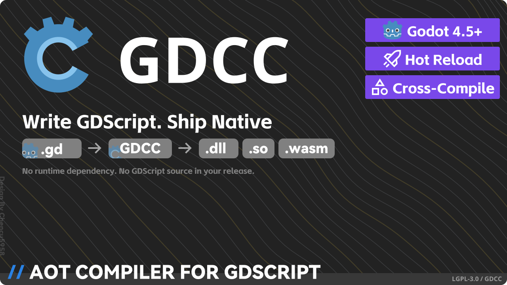

  

  <strong>
    GDCC — <i>GD</i>script to <i>C</i> <i>C</i>ompiler
     
    Write GDScript. Ship native GDExtension binary modules.
  </strong>

  
  
  
  
  
  

 

🌐 [English](README.md) · [简体中文](README.zh-CN.md)

**GDCC is a compiler that turns GDScript into native GDExtension binary modules**, allowing GDScript to run safely and efficiently through Godot Engine's native binary interface.

From now on, write GDScript and get the safety and performance of native C/C++-style modules — with no runtime dependency.

[Download / Releases](https://github.com/script-gd/gdcc/releases) · [CLI documentation](help/cli-usage.md)

## 🚧 Status

> **Beta** — GDCC is currently in beta stage. Please evaluate it against your project before use.

---

## ✨ Features

- 🧩 **Extensible architecture** — modular design for the parser, semantic analyzer, IR lowering, intermediate representation, backend generator, cross-compilation toolchain, and compilation server.
- 🛡️ **Reverse-engineering resistance** — generates native binary modules for GDScript, protecting source code from disclosure fundamentally.
- ⚡ **High performance** — directly generates efficient static GDExtension calls, avoiding the overhead of compatibility layers and dynamic dispatch.
- 🪜 **Progressive migration** — remains compatible with most loosely typed code, allowing gradual migration to a stricter type system for better performance.

## 📸 Editor Preview

*GDCC editor view — GDScript source, build output and hot reload in one dock.*

## 🌟 Highlights

### 🧩 Language & compatibility

- Nearly full `GDScript` feature support, compatible with `Godot >= 4.5.0`, with access to any class, member, and function in the Godot engine.
- Supports code that mixes strongly typed and weakly typed variables; the compiler generates the necessary type-checking and conversion code for weakly typed variables to ensure runtime safety.
- Allows the GDScript interpreter to call code compiled ahead-of-time by GDCC, enabling progressive migration.

### 🛡️ Safety & output

- Safer compiled artifacts: attackers cannot recover source code through decompilation, protecting your intellectual property.
- Faster runtime performance, approaching that of GDExtension modules written in C/C++.
- Compiled artifacts have no dependency on GDCC or any other runtime library — they run directly on the vanilla Godot engine.

### 🚀 Developer experience

- Hot update / hot reload support: after modifying code in the Godot editor, click "Build" to recompile and hot-reload into the running Godot engine.
- Lightning-fast compilation: with the built-in fast compilation backend, GDCC's incremental compile time for ~3000 lines of GDScript is typically under 0.2 seconds.
- First-class cross-compilation support: build GDExtension modules for Windows, Linux, macOS, and more from a single platform.
- 100% transparent, open-source, and verifiable, with over 5000 automated tests ensuring compilation correctness. Moreover, GDCC's Godot editor plugin is compiled by the GDCC compiler itself~

## ⚠️ Limitations

Due to GDExtension limitations, GDScript scripts must have a class name, so the following usages are not supported:

- Path-based `extends` or path-based `preload` from the GDScript interpreter
- Global script or Autoload superclass binding
- Attaching GDCC scripts to nodes; you need to change the node type to attach GDCC code to a node
- Lambdas in property initializers
- Built-in keyed access such as `vector["x"]`; use property-style access such as `vector.x` where supported
- Broad Godot runtime implicit conversions are restricted; in some cases you may need an explicit `as` cast

## 📦 Install

Download GDCC from the [GitHub Releases](https://github.com/script-gd/gdcc/releases) page. The most convenient way to use GDCC is through the GDCC editor plugin:

1. Open the "Asset Library" page, search for "GDCC", and click Install.

   

2. (Optional) If you cannot connect to the network, manually download the plugin package from [GitHub Releases](https://github.com/script-gd/gdcc/releases), then open the "Asset Library" page, click "Import" in the top-right corner, select the downloaded `zip` file, and confirm the import.
3. Click the "Project" tab in the top toolbar, open "Project Settings", go to the "Plugins" tab, and enable the GDCC editor plugin.
4. A "GDCC" tab will appear in the bottom dock; open it and follow the configuration wizard to install (the initial setup requires about 60MB of disk space).
5. Once installed, create a new `.gd3` script, write code, and click "Build" in the top-right corner to compile GDScript into a GDExtension module and hot-reload it into the Godot engine.

**Command line & CI/CD** — You can also install the GDCC platform packages for command-line or CI/CD use; download and extract them to any directory. Normal platform packages are named like `gdcc-<version>-<os>-<arch>.zip` and contain the `gdcc` launcher and other core files that may change between versions. The `*-full.zip` packages contain the same files plus all cross-compilation toolchains needed to run; see [CLI Usage](help/cli-usage.md) for details. Passing a `project.godot` to the CLI compiles the whole project (auto-discovered `.gd3` sources plus explicitly listed `.gd` files) and publishes the result into the project's `bin/` directory.

## ❤️ Community

- 💬 Discord: [https://discord.gg/u22VjH2aQw](https://discord.gg/u22VjH2aQw)
- 👥 QQ Group: 1082512847

## ⭐ Star History

---

2026 © [ScriptGD](https://gdscript.cc) | [LGPL-3.0](LICENSE.md)
<!-- Ciallo～(∠・ω< )⌒★ -->